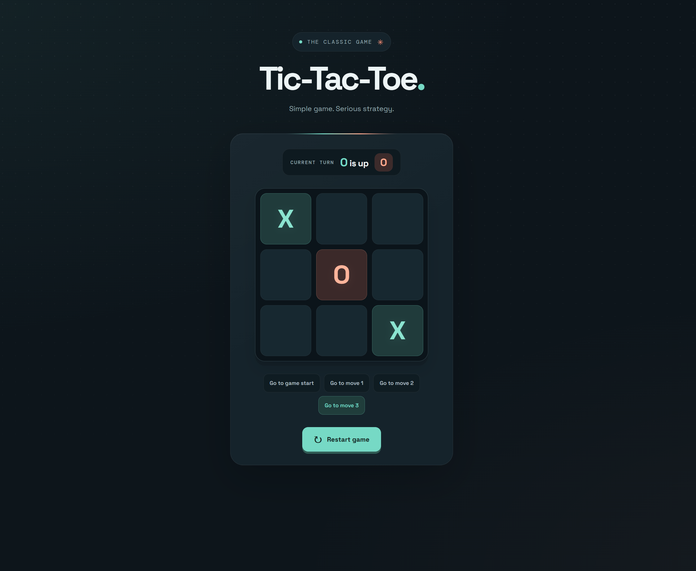

# ❌ Tic-Tac-Toe

A modern, interactive Tic-Tac-Toe game built with **React, TypeScript, and Vite**. Enjoy classic two-player gameplay, visual feedback, move history, and the ability to travel back through previous game states.

## 🎮 Game Preview

<p align="center">
  
</p>

<p align="center">
  <em>A classic game with a modern interface, interactive gameplay, and time-travel functionality.</em>
</p>

## ✨ Features

- 🎯 **Interactive Gameplay** — Play as X and O on a 3 × 3 board.
- 🏆 **Winner Detection** — Automatically identifies the winning player.
- 🤝 **Draw Detection** — Detects when the board is full without a winner.
- 🟢 **Winning Line Highlight** — Highlights the winning combination on the board.
- 🕒 **Move History** — View the sequence of moves made during the game.
- ⏪ **Time Travel** — Jump back to any previous move and explore earlier game states.
- 🔄 **Restart Game** — Reset the board and start a new match.
- 📱 **Responsive Interface** — A clean interface designed for an enjoyable gaming experience.
- 🔒 **Type Safety** — Uses TypeScript for more reliable and maintainable code.
- ⚡ **Fast Development** — Powered by Vite for a fast development workflow.

## 🛠️ Tech Stack

| Technology                                    | Purpose                                  |
| --------------------------------------------- | ---------------------------------------- |
| [React](https://react.dev/)                   | Building interactive user interfaces     |
| [TypeScript](https://www.typescriptlang.org/) | Type safety and maintainability          |
| [Vite](https://vite.dev/)                     | Development server and production builds |
| [ESLint](https://eslint.org/)                 | Code quality and linting                 |
| CSS                                           | Styling and visual presentation          |

## 🚀 Getting Started

Follow the steps below to run the project on your local machine.

### Prerequisites

Make sure you have installed:

- [Node.js](https://nodejs.org/)
- [pnpm](https://pnpm.io/)

### Installation

**1. Clone the repository**

```bash
git clone <your-repository-url>
```

**2. Navigate to the project directory**

```bash
cd <project-directory>
```

**3. Install dependencies**

```bash
pnpm install
```

**4. Start the development server**

```bash
pnpm dev
```

Open the local URL displayed in your terminal to play the game.

## 🎲 How to Play

1. Start with an empty 3 × 3 board.
2. Players take turns placing their marks: **X** and **O**.
3. The first player to align three marks horizontally, vertically, or diagonally wins.
4. If all nine squares are filled without a winner, the game ends in a draw.
5. Use the move history to revisit previous moves.
6. Select any earlier move to travel back to that game state.
7. Restart the game to begin a new match.

## 📜 Available Scripts

| Command        | Description                           |
| -------------- | ------------------------------------- |
| `pnpm dev`     | Starts the development server         |
| `pnpm build`   | Builds the application for production |
| `pnpm lint`    | Runs ESLint to check code quality     |
| `pnpm preview` | Previews the production build locally |

## 🧠 Key Learnings

This project helped me strengthen my understanding of React and TypeScript fundamentals, including:

- Managing component state with `useState`.
- Updating arrays and objects immutably.
- Building reusable components and composing user interfaces.
- Passing data and event handlers through props.
- Separating game logic from UI rendering.
- Deriving game status from the current board state.
- Implementing winner and draw detection.
- Managing move history and navigating between previous states.
- Using TypeScript to improve type safety and code maintainability.

## 📦 Production Build

Create an optimized production build:

```bash
pnpm build
```

Preview the production build locally:

```bash
pnpm preview
```

## 📁 Project Structure

```text
tic-tac-toe/
├── public/
├── assets/
│   └── game.png
├── src/
│   ├── components/
│   ├── App.tsx
│   ├── main.tsx
│   └── index.css
├── index.html
├── package.json
├── tsconfig.json
├── vite.config.ts
└── README.md
```

_Note: The structure above is illustrative. Adjust it to match your actual project files._

## 📄 License

This project is open source. See the [LICENSE](LICENSE) file for license details.

---

<p align="center">
  Built with ❤️ using React, TypeScript, and Vite.
</p>
